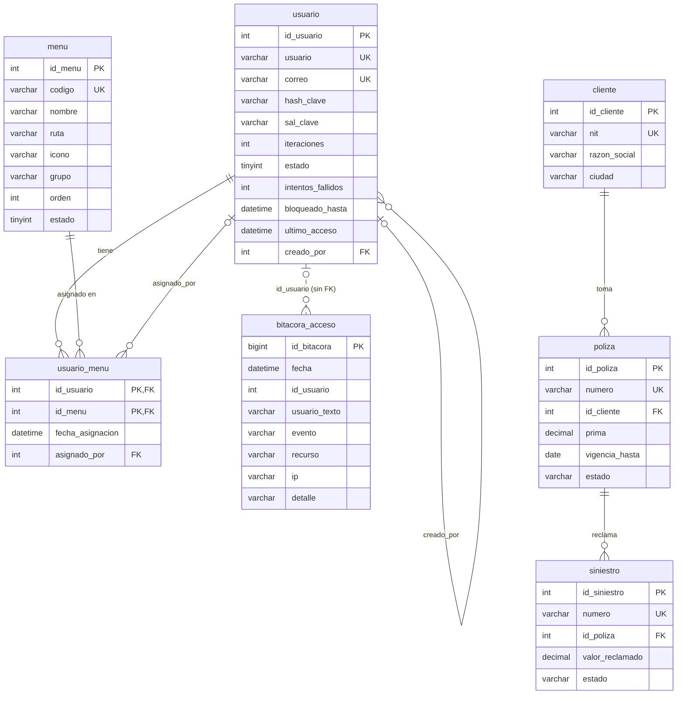

# Base de datos `atalaya_acceso`

MySQL 8, InnoDB, `utf8mb4_unicode_ci`. Scripts:

| Archivo | Contenido |
|---|---|
| `01_esquema.sql` | Crea la BD, borra y crea las 7 tablas con PK, UNIQUE, FKs, CHECKs e índices |
| `02_procedimientos.sql` | Los 16 procedimientos almacenados del contrato |
| `03_datos_iniciales.sql` | Semilla re-ejecutable: 7 menús, 4 usuarios demo, asignaciones, negocio ficticio y ~2 semanas de bitácora |
| `00_instalar_todo.sql` | 01 + 02 + 03 en un solo archivo |

## Modelo entidad-relación



## Decisiones de diseño

- **Tabla puente `usuario_menu`.** Usuario–menú es muchos a muchos. La forma normalizada es una tabla intermedia con PK compuesta `(id_usuario, id_menu)`: impide duplicados, es el índice de la consulta de permiso y permite guardar quién asignó y cuándo. Las FKs con `ON DELETE CASCADE` evitan permisos huérfanos. Guardar los menús en una columna CSV impediría usar FKs, índices y la integridad.
- **`codigo` funcional en `menu`.** El backend protege con `[RequiereMenu("USUARIOS")]`, no con ids autoincrementales que cambian entre ambientes.
- **Claves con PBKDF2-SHA256 + sal + `iteraciones` en columna.** Nunca se guarda la clave. La sal aleatoria por usuario evita las tablas arcoíris y que dos claves iguales den el mismo hash. Las iteraciones van en su propia columna: se pueden subir para los usuarios nuevos sin invalidar los viejos, que se re-hashean en su siguiente login.
- **Solo SPs.** El API no arma SQL concatenado: llama SPs con parámetros tipados. Así no hay inyección SQL, la lógica de datos vive en un solo lugar y el usuario de la aplicación solo necesita `EXECUTE`.
- **Autorización en vivo.** `sp_usuario_tiene_menu` se consulta en cada petición (usuario activo + menú activo + asignado). Usa PK/UNIQUE y responde una sola fila. Quitar un menú o inactivar al usuario corta el acceso de inmediato, sin esperar a que venza el token.
- **Bitácora `bitacora_acceso`.** Es auditoría solo de inserción: logins correctos y fallidos, bloqueos, accesos denegados y cambios de administración. No tiene FK hacia `usuario` a propósito: debe aceptar intentos con usuarios inexistentes y conservar el historial aunque se borre un usuario (por eso también guarda `usuario_texto`). Los índices `(fecha)`, `(evento, fecha)` y `(id_usuario, fecha)` sirven al listado y a los KPIs del tablero.
- **Bloqueo por fuerza bruta.** Lo aplica `sp_usuario_registrar_login`: 5 fallos seguidos ponen `bloqueado_hasta = NOW() + 15 min`. Un fallo durante el bloqueo no lo alarga; cuando el bloqueo vence, el contador vuelve a cero; un login correcto lo reinicia todo. Activar un usuario también limpia el bloqueo.
- **`sp_usuario_menus_reemplazar` en transacción.** Borra solo lo que sobra e inserta solo lo que falta, con lo que conserva la fecha de las asignaciones que se mantienen. Si algo falla, hace `ROLLBACK` + `RESIGNAL`. Solo inserta ids que existen en `menu`.
- **Tablero en una llamada.** `sp_tablero_kpis` devuelve 4 resultsets. La serie de 14 días sale de un CTE recursivo, así que los días sin eventos aparecen en 0.
- **Dinero en `DECIMAL(14,0)`** (pesos, sin decimales), nunca `FLOAT`. El estado de la póliza se recalcula contra la fecha actual en `sp_poliza_listar`, para que no dependa de un proceso nocturno.
- **Unicidad sin distinguir mayúsculas.** Con `utf8mb4_unicode_ci`, `Admin` y `admin` chocan en el UNIQUE. Los duplicados devuelven `SIGNAL '45000'` con `USUARIO_DUPLICADO` o `CORREO_DUPLICADO`, incluso en carreras: el error 1062 del índice se traduce al mismo mensaje.

## Instalación en un MySQL local

```bash
mysql -u root -p < database/00_instalar_todo.sql
```

Para volver al estado de demostración: `mysql -u root -p < database/03_datos_iniciales.sql`.

Usuarios demo (solo pruebas): `admin / Admin#2026`, `analista / Analista#2026`, `consulta / Consulta#2026`, `auditor / Auditor#2026` (inactivo).

## Usuario de aplicación con permisos mínimos

El API solo llama SPs, así que basta con `EXECUTE`. El SP corre con los permisos de su definidor (`SQL SECURITY DEFINER` por defecto), y por eso la aplicación no necesita permisos sobre las tablas.

```sql
CREATE USER 'atalaya_app'@'localhost' IDENTIFIED BY 'UnaClaveLarga#2026';
GRANT EXECUTE ON atalaya_acceso.* TO 'atalaya_app'@'localhost';
-- Opcional, solo si se quiere permitir consultas de diagnóstico de solo lectura:
-- GRANT SELECT ON atalaya_acceso.* TO 'atalaya_app'@'localhost';
FLUSH PRIVILEGES;
```

Luego se copia `src/Atalaya.Web/ConnectionStrings.example.config` como `ConnectionStrings.config` (archivo ignorado por git) y se ponen el servidor, el usuario y la clave.
